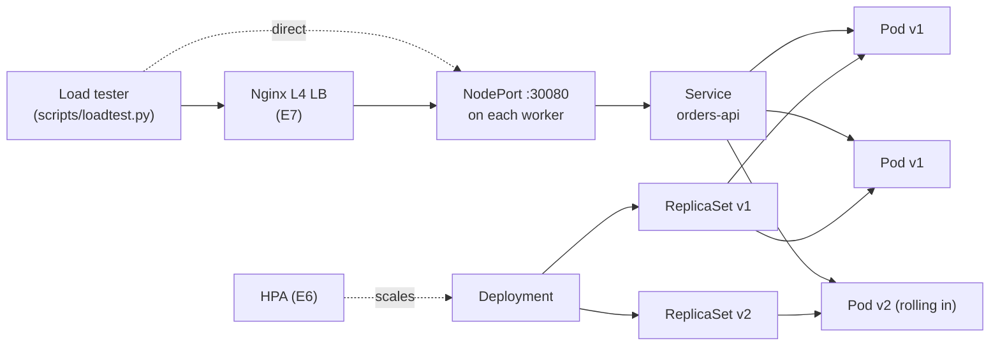

# Zero-Downtime Deployments on Kubernetes, Measured

> **TL;DR:** A Spring Boot service deployed to Kubernetes three ways, from a tutorial-style Deployment to a production-ready one. Each change (readiness probe, graceful shutdown, preStop hook, autoscaling) is tested under constant load, and its effect is measured in failed requests.

| Configuration | Failed requests during a rolling update |
|---|---|
| Naive Deployment | _fill in_ |
| + readinessProbe | _fill in_ |
| + graceful shutdown & preStop | _fill in_ |

<!-- Put the rolling-update GIF here: screenshots/rollout.gif -->

**Stack:** Java 21 · Spring Boot 3 · Kubernetes · Docker · Nginx (L4) · Python load tester

---

## Why this project

Most Kubernetes tutorials stop at `kubectl apply` and "3/3 Running". In production, the hard part is what happens **while things change**: a new version rolls out, a pod is killed, traffic spikes. Kubernetes gives you the tools for zero downtime, but none of them are on by default.

This project answers one question with numbers:

**How many user requests fail during everyday Kubernetes operations, and which setting fixes each failure?**

## The app

`orders-api` is a small Spring Boot service built to make failures visible:

| Endpoint | Purpose |
|---|---|
| `GET /api/info` | Returns the app version and pod name, so a rollout can be watched live |
| `GET /api/work?ms=2000` | A slow request, to test what happens to in-flight requests on shutdown |
| `GET /api/cpu?ms=200` | Burns CPU, to trigger the autoscaler |
| `/actuator/health/readiness` | Readiness probe (DOWN during warm-up) |
| `/actuator/health/liveness` | Liveness probe |

To simulate a realistic service (loading caches, connecting to a database), the app **warms up for 15 seconds** after its port opens. During warm-up it returns `503`.

## Architecture



## Three deployment steps

| Step | Manifest | What changes |
|---|---|---|
| 1 | [`k8s/1-naive`](k8s/1-naive/deployment.yaml) | Typical tutorial Deployment. No probes, no resources, immediate shutdown |
| 2 | [`k8s/2-readiness`](k8s/2-readiness/deployment.yaml) | + `readinessProbe` |
| 3 | [`k8s/3-production`](k8s/3-production/deployment.yaml) | + graceful shutdown, `preStop`, startup/liveness probes, resources, `maxUnavailable: 0` |

## Method

Every experiment uses the same procedure:

1. Deploy one step.
2. Start the load tester: 10 parallel clients for 90 seconds.
3. At second ~10, trigger the event (rollout, pod kill, load spike).
4. Record failed requests, which seconds they happened in, and latency.

Raw data for every run is in [`results/`](results/).

---

## Experiments

### E1: Rolling update, naive Deployment (baseline)

```bash
make deploy STEP=1-naive
make load NODE=<node-ip> NAME=e1-naive     # terminal 1
make rollout-v2                            # terminal 2, after ~10s
```

**Hypothesis:** _what do you expect and why?_

**Result:**

| Requests | Failed | Error types | Seconds with errors |
|---|---|---|---|
| | | | |

**Why:** _explain using the error types (503 = routed to a warming-up pod; connection refused/reset = routed to a pod that was shutting down)_

### E2: + readinessProbe

```bash
make deploy STEP=2-readiness
make load NODE=<node-ip> NAME=e2-readiness
make rollout-v2
```

**Hypothesis:**

**Result:**

| Requests | Failed | Error types | Seconds with errors |
|---|---|---|---|
| | | | |

**Why:** _which errors disappeared, which remain, and why?_

### E3: + graceful shutdown and preStop

Uses slow requests (`/api/work?ms=2000`), because the problem is requests that are **in flight** when a pod receives SIGTERM.

```bash
# run once with step 2, once with step 3
make deploy STEP=2-readiness
python3 scripts/loadtest.py --url http://<node-ip>:30080 --path "/api/work?ms=2000" --duration 90 --name e3-before
make rollout-v2

make deploy STEP=3-production
python3 scripts/loadtest.py --url http://<node-ip>:30080 --path "/api/work?ms=2000" --duration 90 --name e3-after
make rollout-v2
```

**Result:**

| Configuration | Requests | Failed |
|---|---|---|
| Step 2 (immediate shutdown) | | |
| Step 3 (graceful + preStop) | | |

**Why the preStop sleep is needed:** when a pod starts terminating, removing it from the Service endpoints happens asynchronously. Without a short delay, the app can stop accepting connections while kube-proxy is still sending it new ones. _Explain what you observed._

### E4: Rollback

```bash
make rollout-v2
make history
time make undo && kubectl rollout status deployment/orders-api
kubectl get rs -l app=orders-api
```

**Result:**

| Metric | Value |
|---|---|
| Time from `undo` to all pods ready | |
| New ReplicaSet created? | |
| Failed requests during rollback | |

**Why:** _old ReplicaSet kept at 0 replicas; rollback is a scale operation, but every new pod still waits for warm-up._

### E5: Self-healing under load

```bash
make load NODE=<node-ip> NAME=e5-<step>
make kill-pod      # after ~10s
```

**Result:**

| Configuration | Failed requests when a pod is deleted | Time until replacement is Ready |
|---|---|---|
| Step 1 | | |
| Step 3 | | |

### E6: Autoscaling

Requires metrics-server (`kubectl top pods` must work).

```bash
make deploy STEP=3-production && make hpa
python3 scripts/loadtest.py --url http://<node-ip>:30080 --path "/api/cpu?ms=200" --concurrency 20 --duration 300 --name e6-hpa
kubectl get hpa orders-api -w        # another terminal
```

**Result:**

| Metric | Value |
|---|---|
| Load start → HPA decides to scale | |
| HPA decision → new pods Ready | |
| Max replicas reached | |
| p99 latency before / after scale-out | |
| Load stops → scale-in starts | |

**Break it:** remove `resources.requests` and re-apply. _What does `kubectl get hpa` show, and why?_

### E7: Nginx L4 load balancer in front of the nodes

Config: [`lb/nginx.conf`](lb/nginx.conf). Make one worker unreachable on port 30080 while the load test runs through Nginx.

**Result:**

| Setting | Failed requests when a node goes away |
|---|---|
| `max_fails=2 fail_timeout=10s` | |

---

## Key learnings

_Fill in after the experiments. Aim for 4–6 points, each backed by a number above._

## What I'd add next

- PodDisruptionBudget, so node drains can't take down too many pods at once
- Topology spread constraints, so replicas don't land on the same node
- Measuring the same experiments with a real database dependency

## Run it yourself

Requirements: Docker, [kind](https://kind.sigs.k8s.io/), kubectl, Python 3, make.

```bash
make cluster build kind-load metrics-server   # local 3-node cluster + image + metrics
make deploy STEP=1-naive
make load NAME=test
```

On any other cluster: `make build push DOCKERHUB_USER=<you>`, then `make deploy STEP=1-naive DOCKERHUB_USER=<you>` and `make load NODE=<node-ip> NAME=test`.

## Repository layout

```
app/            Spring Boot service + Dockerfile
k8s/            three Deployment steps, Service, HPA
lb/             Nginx L4 load balancer config
scripts/        load tester (Python standard library only)
results/        raw CSV from every run
screenshots/    GIFs and screenshots used in this README
```
