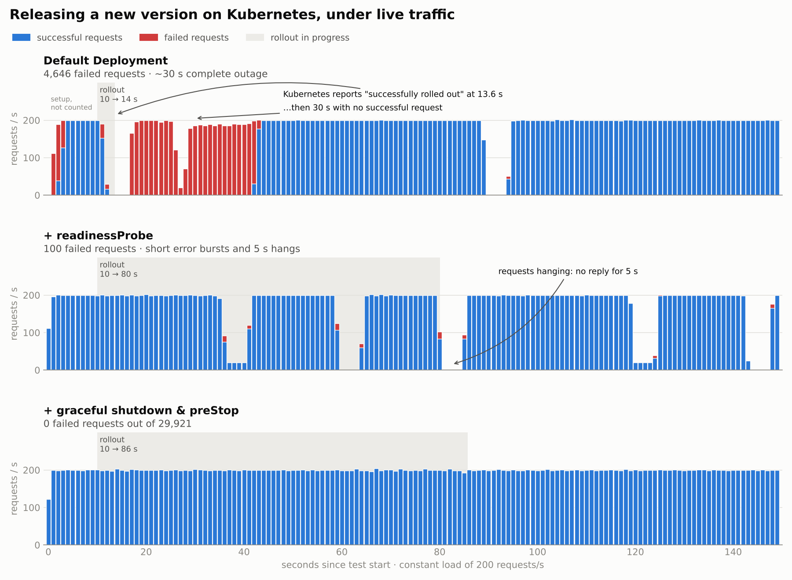
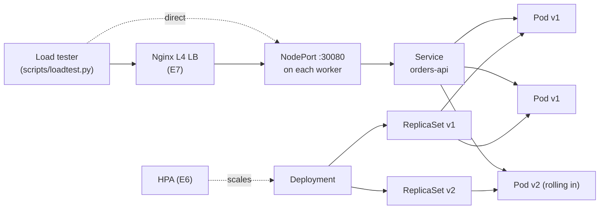

# Zero-Downtime Deployments on Kubernetes, Measured

**In plain words:** when a company releases a new version of its software, users shouldn't notice. With Kubernetes' default settings, my test service went **completely offline for 30 seconds** during a routine release, while Kubernetes reported that everything was fine. I measured exactly why, changed three settings, and got it to **zero failed requests out of 29,921**.



> **TL;DR:** A Spring Boot service deployed to Kubernetes three ways, from a tutorial-style Deployment to a production-ready one. Each change (readiness probe, graceful shutdown, preStop hook) is tested with a rolling update under constant load, and its effect is measured in failed requests.

| Configuration | Failed requests during a rolling update | What users saw |
|---|---|---|
| Naive Deployment | **4,646** | ~30 seconds of complete outage |
| + readinessProbe | **100** | short bursts of errors and 5 s hangs as each old pod died |
| + graceful shutdown & preStop | **0** of 29,921 | nothing |

The naive rollout was also the one Kubernetes reported as finished fastest: `kubectl rollout status` said *successfully rolled out* after 3.6 seconds, while the service stayed completely down for the next 30.

The same settings also made a rollback (E4) and a pod crashing under load (E5) invisible to users: 0 failed requests, compared with 1,450 for a crashed pod in the default setup.

**Stack:** Java 21 · Spring Boot 3 · Kubernetes · Docker · Nginx (L4) · Python load tester

---

## Why this project

Most Kubernetes tutorials stop at `kubectl apply` and "3/3 Running". In production, the hard part is what happens **while things change**: a new version rolls out, a pod is killed, traffic spikes. Kubernetes gives you the tools for zero downtime, but none of them are on by default.

This project answers one question with numbers:

**How many user requests fail during everyday Kubernetes operations, and which setting fixes each failure?**

## The app

`orders-api` is a small Spring Boot service built to make failures visible:

| Endpoint | Purpose |
|---|---|
| `GET /api/info` | Returns the app version and pod name, so a rollout can be watched live |
| `GET /api/work?ms=2000` | A slow request, to test what happens to in-flight requests on shutdown |
| `GET /api/cpu?ms=200` | Burns CPU, to trigger the autoscaler |
| `/actuator/health/readiness` | Readiness probe (DOWN during warm-up) |
| `/actuator/health/liveness` | Liveness probe |

To simulate a realistic service (loading caches, connecting to a database), the app **warms up for 15 seconds** after its port opens. During warm-up it returns `503`.

## Architecture



## Three deployment steps

| Step | Manifest | What changes |
|---|---|---|
| 1 | [`k8s/1-naive`](k8s/1-naive/deployment.yaml) | Typical tutorial Deployment. No probes, no resources, immediate shutdown |
| 2 | [`k8s/2-readiness`](k8s/2-readiness/deployment.yaml) | + `readinessProbe` |
| 3 | [`k8s/3-production`](k8s/3-production/deployment.yaml) | + graceful shutdown, `preStop`, startup/liveness probes, resources, `maxUnavailable: 0` |

## Method

Every experiment uses the same procedure:

1. Deploy one step with v1 and wait until every pod has warmed up.
2. Start the load tester: 10 parallel clients, capped at 200 requests/second, for 150 seconds.
3. At second 10, the load tester itself triggers the rollout to v2, so timing is identical in every run.
4. Record failed requests, which seconds they happened in, and latency.

One command runs the whole procedure: `make experiment STEP=<step> NAME=<name> NODE=<node-ip>`.

The request rate is capped on purpose. Without a cap, a single client opening ~1,200 new TCP connections per second exhausts its own ephemeral ports and reuses stale connection-tracking entries, which produces errors that have nothing to do with the app.

Raw data for every run is in [`results/`](results/).

---

## Experiments

### E1: Rolling update, naive Deployment (baseline)

```bash
make experiment STEP=1-naive NAME=e1-naive NODE=<node-ip>
```

**Hypothesis:** without a readiness probe, Kubernetes considers a new pod ready as soon as its container starts, so traffic reaches it during warm-up and old pods are removed too early.

**Result** ([raw output](results/e1-naive.txt)):

| Requests | Failed during rollout | Error types | Seconds with zero successful requests |
|---|---|---|---|
| 27,121 | **4,646** | 2,712 × HTTP 503, 1,909 × connection refused, 20 × timeout, 5 × reset | **~30** (from 12 s to 42 s) |

_The 333 HTTP 503s in seconds 1 to 3 are excluded: they come from the setup step before the test, where the same missing probe let traffic reach pods that were still warming up._

Timeline of the rollout:

| Seconds | What happened |
|---|---|
| 10 | Rollout to v2 starts |
| 11 to 12 | Old pods are killed; connections refused and reset |
| 13.6 | `kubectl rollout status` reports **successfully rolled out** |
| 13 to 26 | **No successful requests.** All old pods are gone; the new pods' JVMs have not opened their port yet (connection refused) |
| 27 to 41 | **No successful requests.** New pods accept connections but are still warming up (HTTP 503) |
| 42 onward | v2 serves traffic normally |

**Why:** with no readiness probe, "ready" means "the container process started". Kubernetes therefore replaced all three pods within about two seconds, before any new pod could serve a request. The rollout completed from Kubernetes' point of view while the service was down.

### E2: + readinessProbe

```bash
make experiment STEP=2-readiness NAME=e2-readiness NODE=<node-ip>
```

**Hypothesis:** HTTP 503s and the long outage disappear, because Kubernetes now waits for each new pod to report ready before routing traffic to it and before removing the next old pod. Some errors remain when old pods are killed, because they still shut down immediately.

**Result** ([raw output](results/e2-readiness.txt)):

| Requests | Failed | Error types | Rollout duration |
|---|---|---|---|
| 25,091 | **100** | 48 × timeout, 42 × connection refused, 6 × reset, 4 × closed. **No HTTP 503.** | 70 s |

**Why:** the readiness probe fixed the new pods: no request reached a warming-up pod, and v1 and v2 served traffic side by side for most of the rollout. The remaining errors come in three bursts, one each time an old pod was terminated (around 36 s, 59 s and 80 s):

- **connection refused / reset:** the JVM stopped immediately on SIGTERM, while kube-proxy was still routing new connections to it.
- **timeouts (5 s hangs):** requests sent to the IP of a pod that no longer existed got no answer at all, so clients waited until their timeout. In the raw output these show up as seconds where nothing completes, followed by a batch of timeouts.

The rollout took 70 seconds instead of 3.6, because Kubernetes now waited for each new pod's warm-up. Slower, but correct.

### E3: + graceful shutdown and preStop

```bash
make experiment STEP=3-production NAME=e3-production NODE=<node-ip>
```

**Hypothesis:** the remaining errors disappear. The `preStop` sleep keeps the old pod serving while it is removed from the Service endpoints, and graceful shutdown lets requests already in progress finish before the JVM exits.

**Result** ([raw output](results/e3-production.txt)):

| Requests | Failed | Rollout duration | Latency p99 |
|---|---|---|---|
| 29,921 | **0** | 76 s | 15 ms |

No errors, no hangs, and v1 and v2 handed over traffic smoothly from second 35 until the last v1 pod left at second 86.

**Why the preStop sleep is needed:** when a pod starts terminating, two things happen in parallel: the kubelet sends SIGTERM to the container, and the endpoint controller removes the pod from the Service so kube-proxy stops routing to it. Nothing orders the two. Without a delay, the app can stop accepting connections while traffic is still being routed to it, which is exactly the connection refused/reset seen in E2. The 10-second `preStop` sleep makes sure routing is updated first; graceful shutdown then lets in-flight requests finish.

### E4: Rollback under load

The production setup is moved to v2, then rolled back to v1 at second 10 while the load test runs.

```bash
make deploy STEP=3-production && make rollout-v2 && kubectl rollout status deployment/orders-api
python3 scripts/loadtest.py --url http://<node-ip>:30080 --duration 150 --name e4-rollback \
  --event-at 10 \
  --event-cmd "kubectl rollout undo deployment/orders-api && kubectl rollout status deployment/orders-api --timeout=300s"
```

**Hypothesis:** no errors, because a rollback is just another rolling update. But not instant, because every pod still has to start and warm up.

**Result** ([raw output](results/e4-rollback.txt)):

| Requests | Failed | First v1 response | Last v2 response | Rollback complete |
|---|---|---|---|---|
| 29,883 | **0** | 27 s after `undo` | 83 s after `undo` | **82.5 s** |

**Why:** `kubectl rollout undo` scales the previous ReplicaSet back up instead of creating a new one, but its pods are new pods: each one has to start the JVM, warm up and pass its readiness probe before the next old pod is removed. A rollback is safe, but it takes as long as a release. Knowing that number in advance matters during an incident: "roll back" means about a minute and a half for this service, not a few seconds.

### E5: A pod dies under load

At second 10 one pod is deleted while traffic flows, simulating a crashed or evicted pod. Run once with each setup.

```bash
python3 scripts/loadtest.py --url http://<node-ip>:30080 --duration 90 --name e5-<step> \
  --event-at 10 \
  --event-cmd 'kubectl delete pod $(kubectl get pods -l app=orders-api -o jsonpath="{.items[0].metadata.name}") && kubectl rollout status deployment/orders-api --timeout=300s'
```

**Result** ([naive](results/e5-naive.txt), [production](results/e5-production.txt)):

| Configuration | Failed requests | Error types | Kubernetes reported healthy after | Replacement actually serving after |
|---|---|---|---|---|
| Naive | **1,450** | 915 × HTTP 503, 535 × connection refused | 2.4 s | ~25 s |
| Production | **0** of 17,947 | none | 25.7 s | 25.7 s |

_In the naive run, 507 HTTP 503s in seconds 1 to 4 are excluded: they come from the setup step, where pods were still warming up, the same missing-probe problem as in E1._

**Why:** in the naive setup, a third of all requests failed for about 24 seconds. First the deleted pod was still receiving traffic after its process had exited (connection refused), then its replacement received traffic while still warming up (HTTP 503). Kubernetes declared the Deployment healthy 2.4 seconds after the deletion. In the production setup the deleted pod stopped receiving traffic before shutting down, the replacement received none until it was ready, and the two remaining pods absorbed the load. Kubernetes' own health report also became truthful: 25.7 seconds, the real time to replace the pod.

### Planned next

| Experiment | Question | Status |
|---|---|---|
| E3b: Slow in-flight requests | With 2-second requests in progress when SIGTERM arrives, does graceful shutdown let them finish? | Planned |
| E6: Autoscaling | Under a CPU spike, how long until new pods actually serve traffic? ([`k8s/hpa.yaml`](k8s/hpa.yaml) is ready) | Planned |
| E7: Nginx L4 load balancer | When a whole node disappears, how many requests fail before the load balancer stops sending to it? ([`lb/nginx.conf`](lb/nginx.conf) is ready) | Needs a multi-node cluster |

---

## Key learnings

- **A rolling update is not zero-downtime by default.** With a tutorial-style Deployment, a routine release took the service down for ~30 seconds and failed 4,646 requests (E1).
- **"Rolled out" is not the same as "serving".** Kubernetes reported the naive rollout complete after 3.6 seconds, while the app was still unable to answer a single request. Without a readiness probe, Kubernetes only knows the process started.
- **Readiness probes fix new pods, not old ones.** Adding one removed every HTTP 503 and the long outage, but 100 requests still failed as old pods were killed (E2).
- **Shutdown needs as much care as startup.** Routing updates and SIGTERM happen in parallel. A `preStop` delay plus graceful shutdown took failures from 100 to 0 out of 29,921 requests (E3).
- **Rollback is not instant.** Rolling back took 82.5 seconds with zero errors (E4): safe, but as slow as a release, because every pod must warm up again.
- **The same settings protect against crashes, not just releases.** Deleting a pod under load failed 1,450 requests without them and none with them (E5).
- **Safe rollouts are slower, and that's the point.** The rollout went from 3.6 s (broken) to 76 s (zero errors), because Kubernetes now waits for each pod to be genuinely ready.
- **Measure the measuring tool.** An uncapped load tester exhausted its own ephemeral ports and reused stale connection-tracking entries, producing errors that had nothing to do with the app. Capping the client rate removed them.

## What I'd add next

- PodDisruptionBudget, so node drains can't take down too many pods at once
- Topology spread constraints, so replicas don't land on the same node
- Measuring the same experiments with a real database dependency

## Run it yourself

Requirements: Docker, [kind](https://kind.sigs.k8s.io/), kubectl, Python 3, make.

```bash
make cluster build kind-load metrics-server   # local 3-node cluster + image + metrics
make deploy STEP=1-naive
make load NAME=test
```

On any other cluster: `make build push DOCKERHUB_USER=<you>`, then `make deploy STEP=1-naive DOCKERHUB_USER=<you>` and `make load NODE=<node-ip> NAME=test`.

## Repository layout

```
app/            Spring Boot service + Dockerfile
k8s/            three Deployment steps, Service, HPA
lb/             Nginx L4 load balancer config
scripts/        load tester (Python standard library only)
results/        raw CSV from every run
screenshots/    GIFs and screenshots used in this README
```
